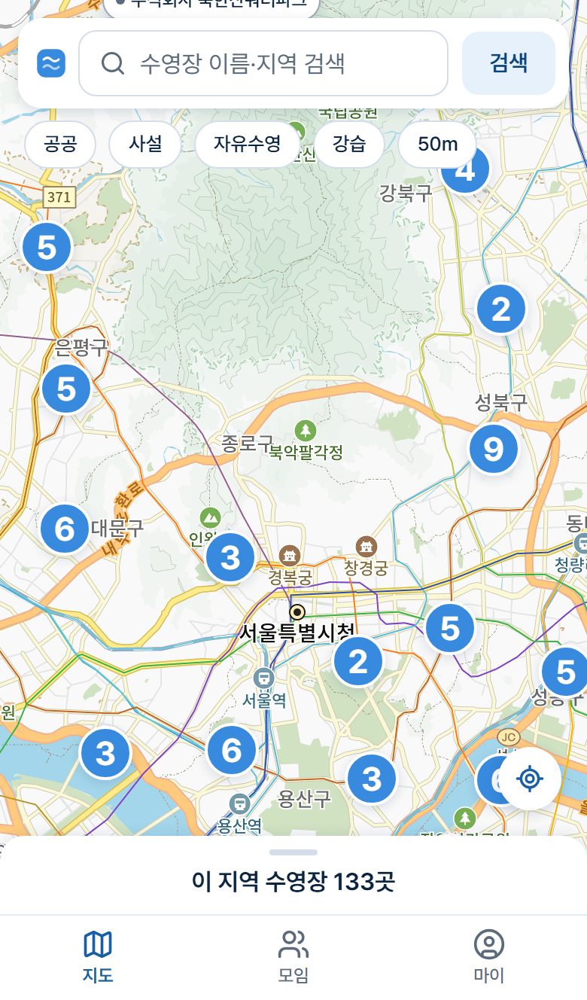
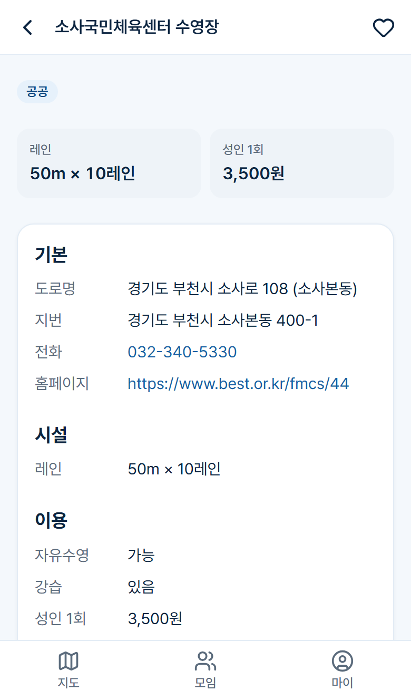
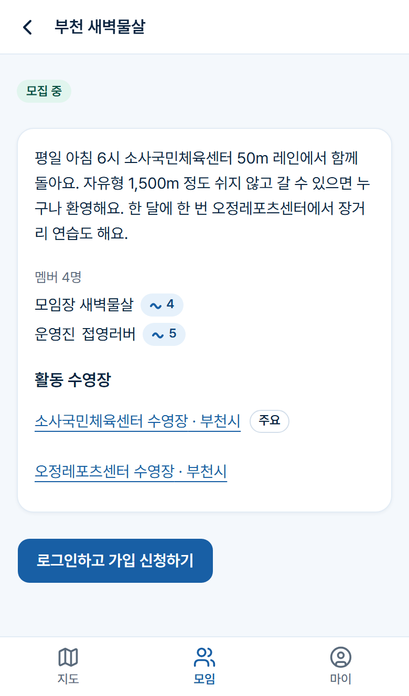
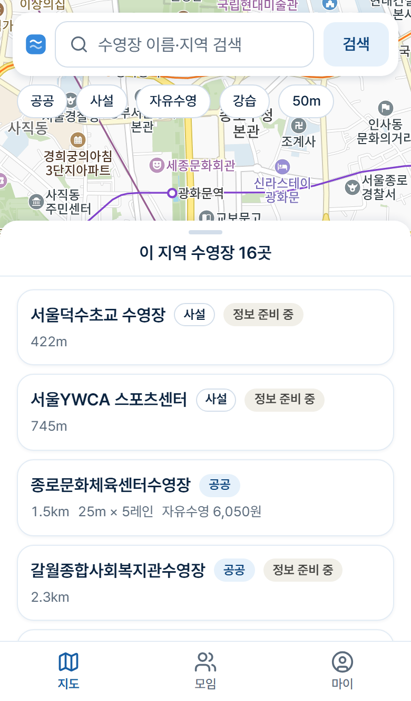
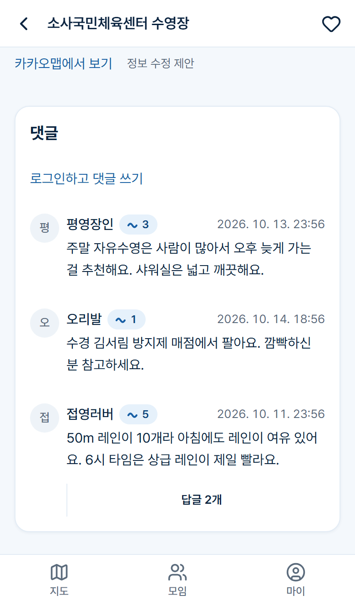
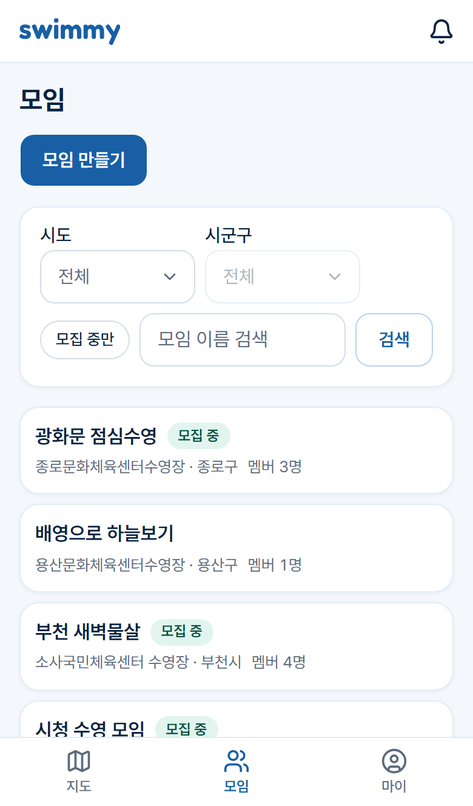

# Swimmy (가칭)

**수영인을 위한 커뮤니티 웹 서비스.** 내 근처 수영장을 지도에서 찾고, 자유수영·강습·요금 정보를 확인하고, 같은 수영장에서 함께 돌 모임을 찾을 수 있습니다.

> 이 저장소는 프로젝트 소개용입니다. 소스 코드는 비공개 저장소에서 개발하고 있으며, 정식 출시를 목표로 1인 개발 중입니다.

  
  
  

## 왜 만들었나

수영을 좋아해서 이곳저곳 수영장을 다니다 보니 두 가지가 늘 아쉬웠습니다.

- **수영장 정보를 한눈에 볼 수 있는 곳이 없었습니다.** 레인 규격, 자유수영 시간, 요금 같은 정보가 지자체·공단 홈페이지마다 흩어져 있고 형식도 제각각이라, 새 수영장을 찾을 때마다 여러 사이트를 뒤져야 했습니다.
- **수영 동아리 정보를 얻을 곳이 없었습니다.** 함께 수영할 모임을 찾고 싶어도 어떤 동아리가 어느 수영장에서 활동하는지 알 수 있는 곳이 마땅치 않았습니다.

그래서 직접 만들어 봤습니다. Swimmy는 **수영장 정보**와 **수영 동아리(모임)**를 한 곳에 모아, 내 근처 수영장을 찾고 그 수영장에서 함께 수영할 사람들까지 만날 수 있게 하는 것을 목표로 합니다.

## 주요 기능

### 수영장 찾기

- 카카오맵 기반 지도 홈. 줌 아웃하면 마커가 묶이고, "이 지역에서 검색"으로 보이는 영역을 다시 찾습니다.
- 공공/사설, 자유수영, 강습, 50m 레인 필터와 이름·지역 검색.
- 수영장 상세: 레인 규격, 수심, 성인 자유수영 1회 요금, 요금 메모, 운영시간, 휴관일, 전화·홈페이지.
- 전국 1,500곳이 넘는 수영장 위치 데이터를 공공데이터로 가져오고, 수도권 공공 수영장 180곳은 상세 정보를 직접 확인해 채웠습니다.
- 찜, 댓글(1단계 답글), 정보 수정 제안.

### 모임(길드)

- 모임 만들기, 지역·모집 여부·이름으로 찾기, 내 근처 모임.
- 가입 신청 → 모임장 승인, 가입 질문, 멤버에게만 보이는 카카오톡 오픈채팅 링크.
- 모임장·운영진·멤버 3단계 권한, 모임장 위임과 해산.
- 수영장 상세에서 "이 수영장에서 활동하는 모임"을 바로 볼 수 있습니다.

### 커뮤니티 안전과 운영

- 신고, 회원 간 차단, 인앱 알림.
- 관리자 화면: 대시보드, 신고 처리, 댓글 숨김, 회원 제재(경고·기간 정지·영구 정지), 모임 관리, 감사 로그.
- 수영장 데이터 관리: 공공데이터 매칭 검토, 중복 확인, 수정 제안 처리.

  
  
  

## 기술 스택

| 영역      | 사용 기술                                                    |
| --------- | ------------------------------------------------------------ |
| 앱        | Next.js (App Router), React, TypeScript                      |
| UI        | Tailwind CSS, shadcn/ui, Pretendard                          |
| DB        | PostgreSQL 17 + PostGIS, Drizzle ORM (SQL 마이그레이션)      |
| 인증      | Better Auth (DB 세션, 이메일 인증)                           |
| 지도      | 카카오맵 JS SDK, 카카오 로컬 API (지오코딩)                  |
| 테스트    | Vitest (실제 테스트 DB에 붙는 서비스 테스트), Playwright E2E |
| 로컬 환경 | Docker Compose (PostgreSQL, Mailpit)                         |
| 품질 관리 | ESLint, Prettier, commitlint, husky, lint-staged             |

## 설계에서 신경 쓴 점

- **이관 가능한 서비스 계층.** 비즈니스 로직과 권한 검사는 서비스 계층에만 두고, 서비스는 Next.js에 의존하지 않습니다. 나중에 백엔드를 Spring으로 옮기더라도 서비스 테스트가 그대로 명세 역할을 합니다. DB 스키마도 JPA로 옮기기 쉬운 규칙(snake_case, UUID v7, enum은 text + CHECK, 감사 컬럼)을 따릅니다.
- **중요한 규칙은 DB 제약으로.** "한 사람은 한 모임에만", "모임장은 한 명"을 애플리케이션 검사만이 아니라 부분 유니크 인덱스로 보장합니다.
- **멱등 데이터 가져오기.** 공공데이터 가져오기는 여러 번 실행해도 결과가 같고, 관리자가 직접 고친 필드는 덮어쓰지 않습니다. 엉뚱한 공공데이터 좌표는 주소로 다시 찾습니다.
- **콘텐츠 노출 규칙을 한 곳에서.** 숨김·삭제·차단·제재로 인한 일괄 숨김을 공용 헬퍼로만 적용해, 화면마다 조건이 어긋나지 않게 했습니다.
- **스케줄러 없는 정지 만료.** 기간 정지는 로그인 시점에 만료를 처리하고, 정지된 모임장의 모임은 자동으로 "모임장 없음" 상태로 전환됩니다.
- **결정은 기록으로.** 되돌리기 어려운 결정 18건을 ADR(Architecture Decision Record)로 남겼습니다.
- **규칙을 훅으로 강제.** 커밋과 작업 종료 시점에 린트·포맷·타입 검사를 돌리고, 서비스 코드를 바꾸면 짝 테스트가, 의존성·인증·스키마 규칙을 바꾸면 새 ADR이 있어야 통과합니다.
- **데이터 출처 존중.** 지도 서비스 스크래핑이나 다른 서비스의 데이터·사진 복제는 하지 않습니다. 공공데이터와 직접 확인한 정보만 씁니다.

## 진행 상황

- [x] 기반 구축: 인증, 온보딩, 앱 셸, 규칙 강제 장치
- [x] 수영장 데이터 가져오기와 관리자 기능
- [x] 수영장 지도·상세·찜·검색
- [x] 댓글과 커뮤니티 안전(신고·차단)
- [x] 모임: 등록, 가입 신청·승인, 권한, 위임·해산
- [x] 회원 제재·탈퇴, 신고 처리 대시보드, 감사 로그
- [x] 디자인 시스템
- [x] 수도권 공공 수영장 상세 정보 데이터
- [ ] 자유수영 시간표와 "지금 자유수영 중인 수영장" 필터 ← 진행 중
- [ ] 출시 준비 (배포, 도메인, 운영)

이후에는 수영 일지와 활동 잔디, 게시판, 수영장 구조화 리뷰 등을 계획하고 있습니다.

규모: 서비스·통합 테스트 파일 83개, E2E 시나리오 12개, DB 마이그레이션 12개 (2026년 10월 기준)

---

스크린샷은 로컬 개발 환경에서 데모 데이터로 찍었습니다. 지도 © Kakao.
